# Gable — Next.js Coworking Booking Template

A production-ready booking website for a coworking network: desks, meeting rooms, phone booths, studios, event spaces and day offices across several buildings. Built with **Next.js 15**, **Tailwind CSS v4** and the **Opencals Storefront SDK**.

**[View Live Demo →](https://template-gable.vercel.app)**

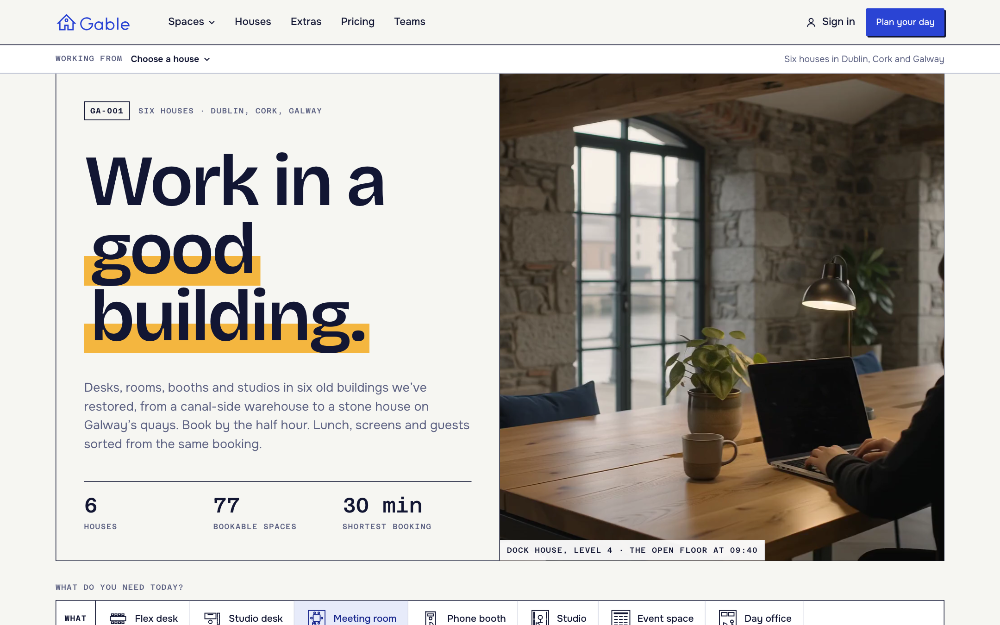

Gable is a fictional network of six workspaces in restored buildings in Dublin, Cork and Galway. The site is drawn as the architect's drawing set for those buildings. Every section is a numbered sheet, every summary is a title block, booking lengths are dimension lines and booked time is hatched like a cut wall. The booking model is "plan your day": put a desk, a room for the 11 o'clock and a booth for the call after on one **day sheet**, and check out once. Extras and upgrades are suggested in the gaps of that day. MIT licensed: clone it, rebrand it, ship it.

---

## Get Started in 3 Steps

### 1. Create an Opencals account

Sign up at **[app.opencals.com](https://app.opencals.com)** and create a **Dev Store** in **Ireland** (the store's country sets the currency: EUR). When prompted for a dataset, choose **Gable (Coworking)**. This seeds six houses with addresses and coordinates, 77 bookable spaces, 16 extras, three discounts and the checkout questions, so the template looks like the demo.

### 2. Get your API key

In **User Account Settings** in the Opencals dashboard, generate a **private storefront key** (`spk_`). The template calls the API from its server, so the key stays secret, and it forwards each visitor's IP (`nextBuyerIp` in `lib/opencals.ts`) so each visitor gets their own rate limits. A public key (`sfk_`) also works, but then all visitors share your server's limits.

### 3. Deploy to Vercel

[](https://vercel.com/new/clone?repository-url=https%3A%2F%2Fgithub.com%2Fletsopencals%2Ftemplate-gable&env=OPENCALS_API_KEY,AUTH_SECRET&envDescription=API%20key%20from%20your%20Opencals%20dashboard%20and%20a%20random%20secret%20for%20auth&project-name=gable&repository-name=template-gable)

| Variable | Value |
|----------|-------|
| `OPENCALS_API_KEY` | Your private storefront key (starts with `spk_`) |
| `AUTH_SECRET` | Any random string, used for session encryption |
| `NEXT_PUBLIC_STRIPE_PUBLISHABLE_KEY` | *(optional)* Stripe publishable key, if the API doesn't return one |
| `GABLE_PREVIEW` | *(optional)* `1` serves the `/preview` fixture screens in production |

---

## The Site

A homepage with a quick query bar (what, where, when, from, people, how long), a **Free right now** board that shows seats left on each open floor and the rooms you could walk into in the next hour, the six houses, the kinds of space, extras, teams and FAQ. Everything bookable comes from your store.


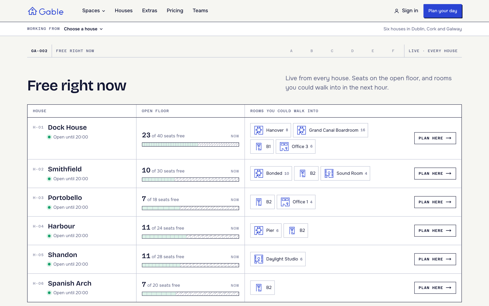

- **Houses** (`/houses`): a hand-drawn location plan of Ireland with a Dublin Bay inset, and a schedule of the houses.
- **A house** (`/houses/[slug]`): photo, story, a live board, the spaces by kind, hours, getting there and arrival notes.
- **Spaces** (`/spaces`): the whole catalogue, filtered by kind, house, seats and kit, with the filters in the URL.
- **A space** (`/spaces/[slug]`): photos, the room data sheet (seats, level, kit, price by length), a plan locator, and a booking panel with a day bar and plain start times.
- **Kind pages**: `/desks`, `/meeting-rooms`, `/studios`, `/events`, `/day-offices`.
- **Extras** (`/extras`), **Pricing** (`/pricing`, from-prices per kind plus a "price a whole day" builder), **Teams**, **About**, **FAQ**, **Contact**, terms and privacy.

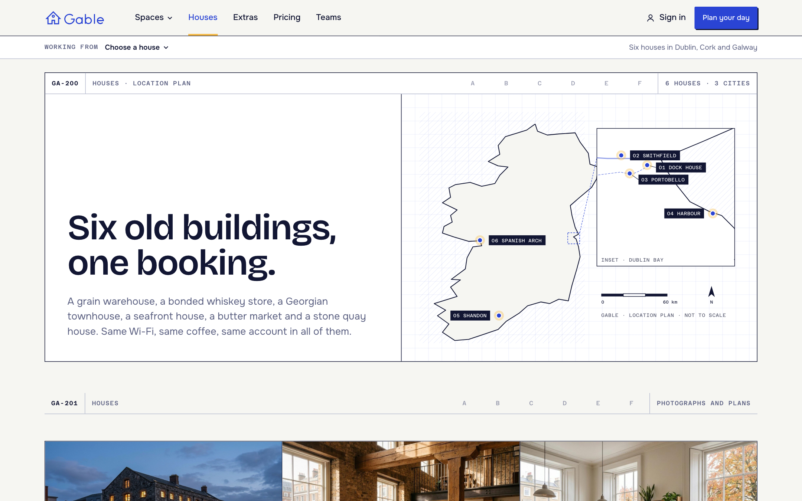

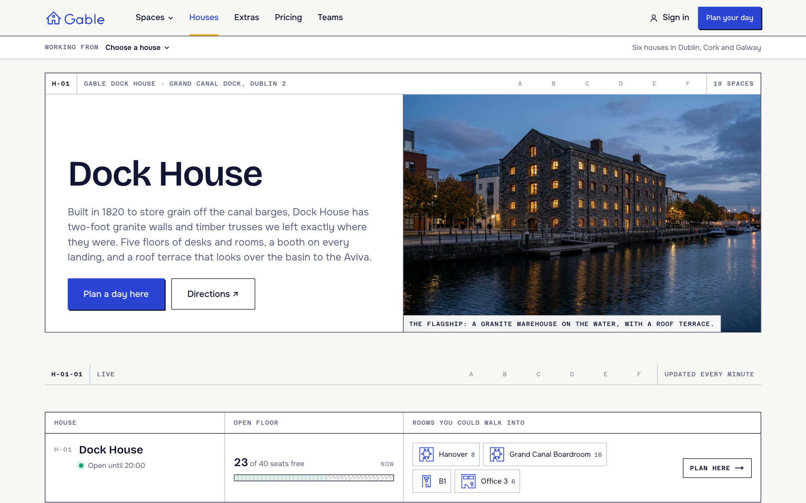

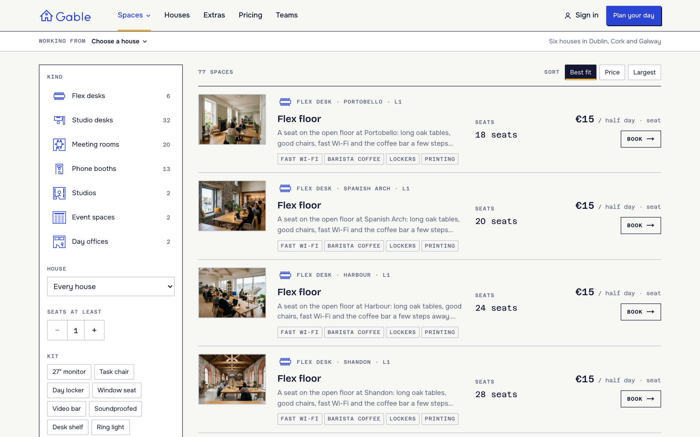

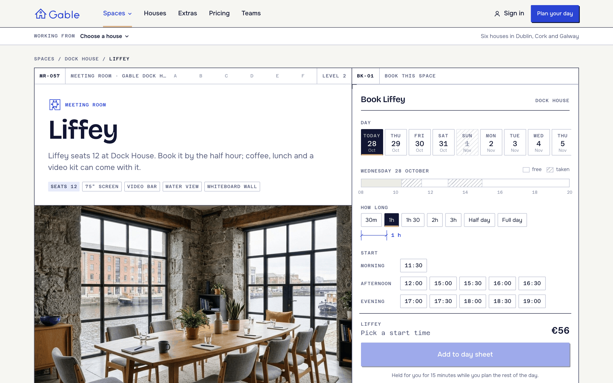

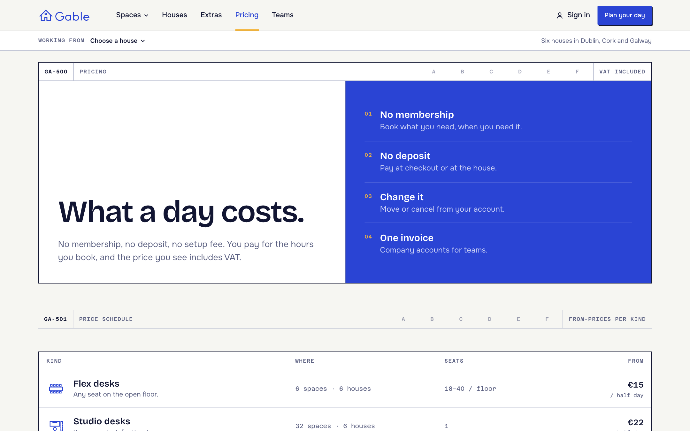

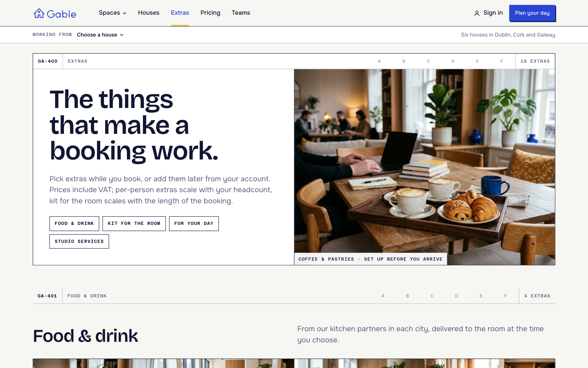

---

## What's Included

### The Planner (`/book`)

A search, not a wizard. Pick a house, a day (two weeks ahead, closed days struck through), how long (dimension-line chips: 30 min to a full day for rooms, half day / full day / late for desks), a start time and how many people. The results are the spaces that fit: photo, seats, kit, the price for that span, a day bar with the booked time hatched, and a state ("Free at 10:00", "Next free 14:30", "23 seats free"). Choose one to open its day column and extras, then **Add to day sheet**. The planner state lives in the URL (`/book?house=dock-house&kind=room&date=…&start=10:00&length=60&people=6`), so a link from the home query bar or a space page lands on the exact search.

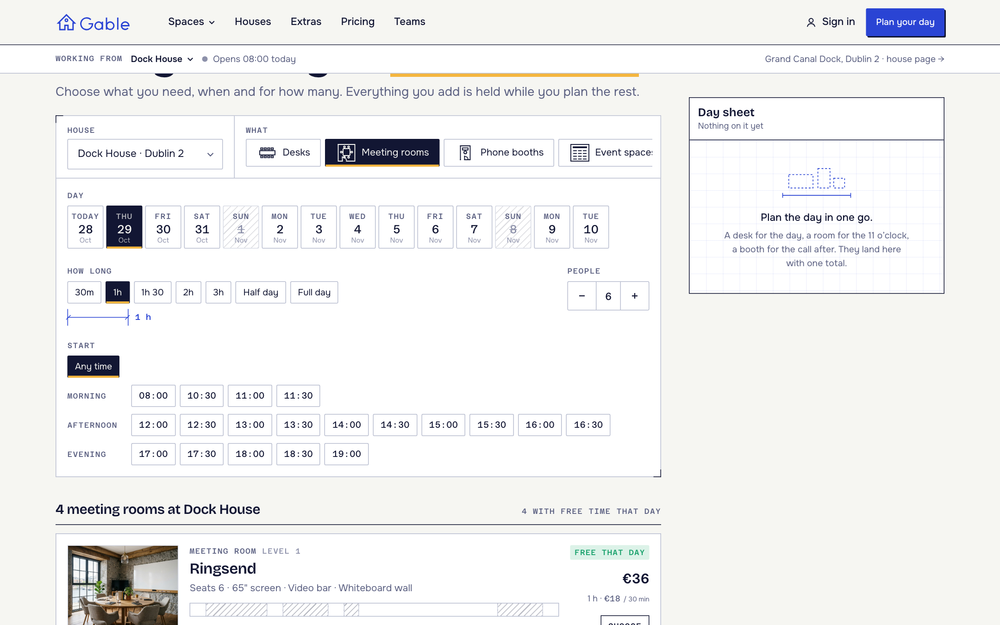

**Fast by design.** The page makes **one request per house**: `/api/houses/[id]/availability` reads every space's merged free ranges for the whole booking window once (`getCurrentAvailabilitiesMerged` without a date), caches each space for 60 seconds on the server, and returns packed `[start, length, taken, capacity]` spans. Fits, "free now", next free, seats left and the day strip are computed in the browser, so changing the day, length, start or people never calls the API. A booking, cancel, reschedule or cart removal invalidates the cached spaces at once.

### The Day Sheet (a multi-item cart)

The day sheet is the cart, drawn as a timeline of the day: every booking is a block on the 08:00–20:00 line, with its extras, discounts, the hold timer, the total and **Check out** always in view (a right rail on desktop, a bar and drawer on phones). Bookings are held for 15 minutes while you plan the rest. Under **Fits in your day** it suggests what the day is missing:

- a desk around your meetings on the same open floor;
- a booth in the half hour between two meetings;
- lunch or coffee for the number of people in a room;
- a bigger room that's free at the same time ("Hanover is free too: 2 more seats");
- parking at houses that have it.

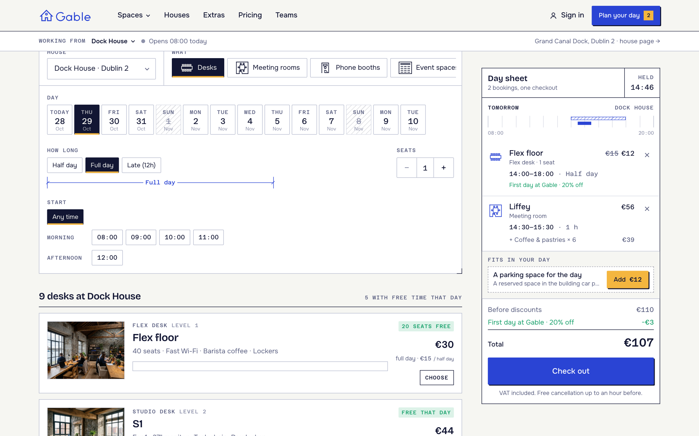

### Checkout

One checkout for the whole day: who's booking (or sign in), the store's checkout questions (company for the invoice, meeting name for the door screen, dietary needs), a discount code, and payment with your store's providers: card via Stripe Elements, or pay at the house. Room bookings can invite guests by email; they get the calendar invite. Signed out customers are signed in after checkout with the checkout token.

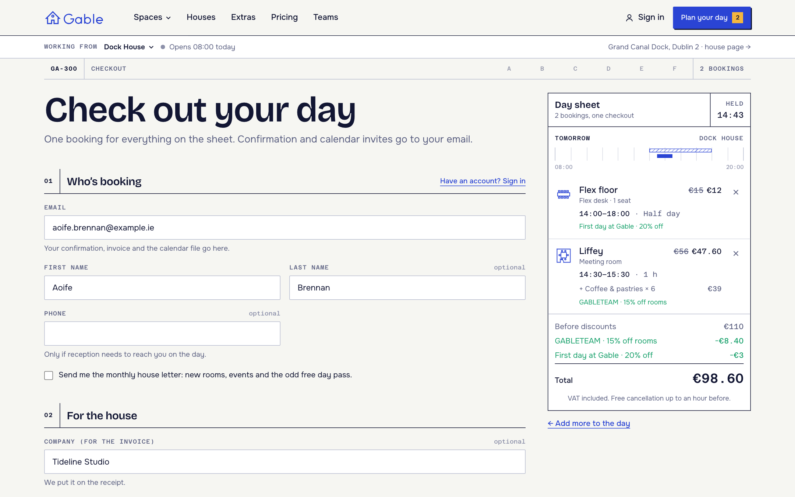

### The Day Sheet Printout (confirmation)

`/thank-you` is a drawing sheet: a section through the house with every booked space on its floor and a dashed route from the front door, the title block (house, date, bookings, total, payment), the day's timeline, getting in (reception, Wi-Fi), getting there (address, transit, parking, map link), invite people, **Add to calendar** (.ics), and **Print day sheet** (the site chrome is hidden in print).

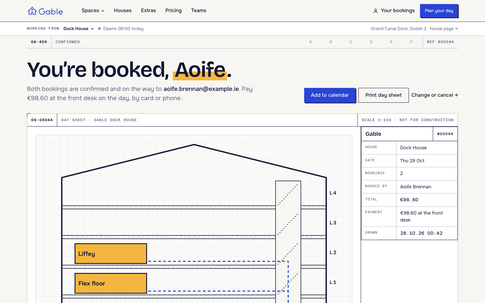

### Customer Accounts

Passwordless sign-in by default: enter your email and type the 6-digit code (password sign-in stays available). The account opens on the **Week plan**: seven columns, Monday to Sunday, every booking drawn to scale (desks hatched, rooms solid), then what's coming up with **Change time**, **Stay longer**, **Invite** and **Cancel**, past bookings with **Book again**, receipts and profile.

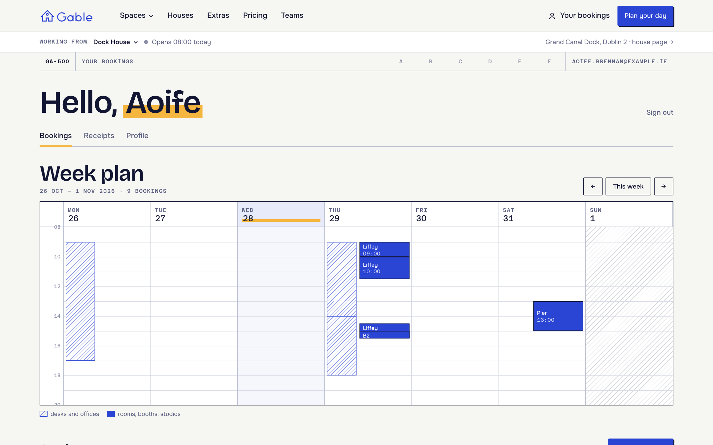

Review the post-booking screens without a store at **`/preview`** (fixtures built from your live catalogue; on in development, or set `GABLE_PREVIEW=1`).

One-time email links from Opencals (view, reschedule or cancel a booking, feedback, verify email, reset password) resolve through `/link/[token]`, which signs the customer in and redirects to the right place.

> **Set your Storefront Base URL.** For emailed links to point back to this app, set **Storefront Base URL** in your Opencals dashboard (Settings → API) to your deployed URL. Opencals builds every customer link as `{storefrontBaseUrl}/link/{token}`.

### Mobile

The whole flow works at 390 px: the planner stacks, the space's composer keeps the price and **Add to day sheet** in view, and the day sheet becomes a bottom bar that opens a drawer.

<p align="center">
  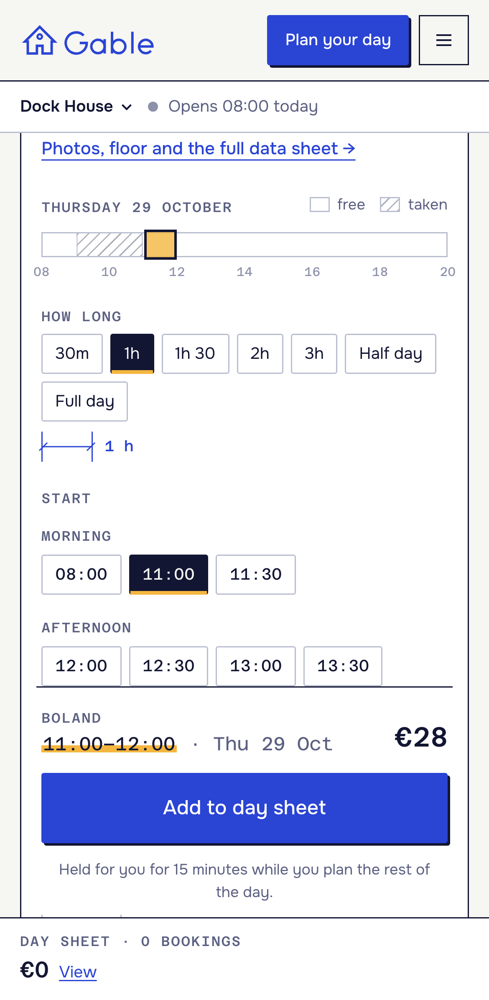
  &nbsp;&nbsp;
  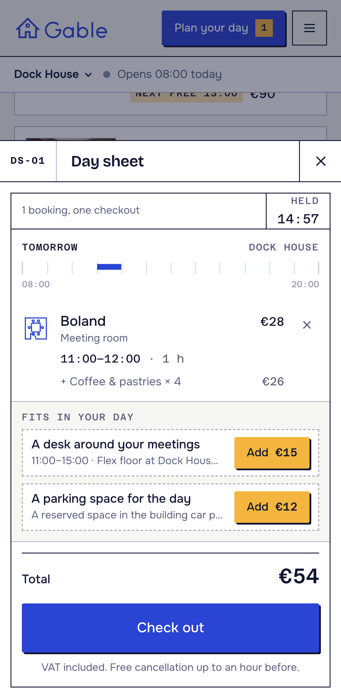
</p>

### SEO

Per-page metadata, Open Graph images, `Organization` and `CoworkingSpace` structured data per house, `FAQPage` on the FAQ, robots.txt and sitemap.xml.

---

## Data Model (store conventions)

The template reads everything bookable from your store and parses a few conventions (`lib/workspace.ts`):

- **House = store location** (physical), with address and coordinates. Photos, arrival notes, Wi-Fi, getting there and hours copy per house live in `siteConfig` and are matched by location slug.
- **Space = one product variant**, assigned to exactly one house, with no staff and no pool, so each space is its own resource (the Opencals *Self* rule). Product groups are per kind per house: title `Meeting room · Dock House`, variant title = the space's own name (`Liffey`, `S3`, `B1`, `Flex floor`).
- **Kind = collection.** `siteConfig.kinds` maps a collection to a kind: `flex-desks`, `studio-desks`, `meeting-rooms`, `phone-booths`, `studios`, `event-spaces`, `private-offices`.
- **Seats.** A room, studio, event space or day office seats `maxGuests + 1` (`allowGuests: true`; the guests are the meeting invitees). The flex floor is **one product per house with `maxAttendees` = its seats**: a team books several seats with `numberOfAttendees`, and the availability ranges' `attendees` / `maxAttendees` drive "N seats free". Booths and studio desks seat one.
- **Length and price.** Every space has `allowCustomDuration`: rooms and booths on a 30-minute base, studios on 1 hour, desks, events and offices on 4 hours (a half day). The price scales as `ceil(booked / base) × price`.
- **Description.** One or two sentences of copy, then optional fact lines: `Level: 2` and `Kit: 75" screen, Video bar, Whiteboard wall`.
- **Extras = add-ons**, scoped to products and locations. Per-person extras use `maxQuantity`; kit priced by the hour uses `durationMultiplied`.
- **Discounts.** The seed has an automatic 20% off flex desks on a first order, the code `GABLETEAM` (15% off meeting rooms) and 25% off rooms on Friday afternoons.

---

## Tech Stack

| Category | Technology |
|----------|-----------|
| Framework | Next.js 15 (App Router) |
| Styling | Tailwind CSS v4 |
| Fonts | next/font: Bricolage Grotesque, Onest, Azeret Mono |
| Motion | CSS only: SVG draw-on, dimension stretch, hatch sweep, highlighter wipe |
| Data | React Server Components + SWR (seeded with `fallbackData`) |
| Forms | react-hook-form + Zod |
| Payments | Stripe Elements |
| Auth | NextAuth.js v5 |
| Dates | moment-timezone |
| API | Opencals Storefront SDK (v0.3.19) |

---

## Local Development

```bash
git clone https://github.com/letsopencals/template-gable.git
cd template-gable
npm install
cp .env.example .env.local
```

Edit `.env.local`:

```
OPENCALS_API_KEY=spk_your_key_here
AUTH_SECRET=change_me_to_a_random_string
```

```bash
npm run dev
```

Open [http://localhost:3000](http://localhost:3000).

---

## Customization

- **`lib/site-config.ts`**: name, contact, the collection → kind mapping (labels, blurbs, plan icons), house presentation (photo, story, arrival notes, Wi-Fi, getting there), extras groups, pricing copy, teams, testimonials and FAQ.
- The bookable data (houses, spaces, seats, prices, hours, availability, extras, questions, discounts) comes from your Opencals store.
- **Theme**: tokens in `app/globals.css` (`@theme`) and the design contract in `DESIGN.md`.

```css
@theme {
  --color-paper: #f6f6f2;     /* page */
  --color-sheet: #ffffff;     /* cards, fields */
  --color-ink: #121633;       /* text and frames */
  --color-cobalt: #2a44d4;    /* the brand: actions, drawings */
  --color-marigold: #f4b63f;  /* the highlighter: the one thing you chose */
}
```

---

## Project Structure

```
app/
  page.tsx                     # Home
  houses/ spaces/              # Houses, the catalogue, house and space pages
  desks/ meeting-rooms/ studios/ events/ day-offices/
  extras/ pricing/ teams/ about/ faq/ contact/ terms/ privacy/
  book/                        # The planner
  checkout/ thank-you/         # Checkout and the day sheet printout
  account/ auth/ link/[token]/
  preview/[screen]/            # Fixture screens
  api/                         # API routes: SDK calls server-side, per-house availability

components/
  ui/ layout/ site/            # Drawing-set primitives, header + house bar, content blocks
  home/                        # Hero, query bar, free right now
  planner/                     # Date strip, length and time chips, day bar, space composer
  day-sheet/                   # The cart as a day timeline, suggestions, phone drawer
  checkout/ confirmation/ account/

lib/
  workspace.ts                 # Catalogue: houses, spaces, extras from the store conventions
  workspace-time.ts            # Availability maths on packed ranges
  availability-server.ts       # Cached per-space merged ranges
  upsell.ts                    # "Fits in your day" suggestions
```

---

## Other Templates

Gable is one of the open-source booking templates built on the Opencals Storefront SDK. Same backend, different design and vertical:

- **[Clear Care](https://github.com/letsopencals/template-clarity)** — a medical clinic template with department-first booking. [Live demo](https://template-clarity.vercel.app)
- **[Frisor](https://github.com/letsopencals/template-frisor)** — a modern barbershop template with a dark editorial palette. [Live demo](https://template-frisor-sage.vercel.app)
- **[HAAR](https://github.com/letsopencals/template-haar)** — a hair-salon booking template with a light, warm palette. [Live demo](https://template-haar.vercel.app)
- **[VOLT](https://github.com/letsopencals/template-volt)** — a multi-club padel & squash template with a live hall map and court grid. [Live demo](https://template-volt.vercel.app)
- **[NOIR Drive](https://github.com/letsopencals/template-noir)** — a luxury car-rental template (Dubai) with multi-day rentals and chauffeur packages. [Live demo](https://template-noir.vercel.app)
- **[Fluently](https://github.com/letsopencals/template-fluently)** — a language-school template (New York) with group classes, live seats, private lessons and online lessons. [Live demo](https://template-fluently.vercel.app)
- **[Bali Villa Rentals](https://github.com/letsopencals/template-bali-villas)** — a villa-rental template (Bali, demo brand Lumbung Sidemen) with nightly stays and fixed check-in and check-out. [Live demo](https://template-bali-villas.vercel.app)
- **[Tensile](https://github.com/letsopencals/template-reformer)** — a reformer Pilates studio template (Berlin) with a multi-studio class timetable, beds left, privates and workshops. [Live demo](https://template-reformer.vercel.app)
- **[Alba Dental](https://github.com/letsopencals/template-alba)** — a dental group template (London) with five studios, a Smile Check on a tooth chart, a chair-time booking planner and a cut-paper kids site. [Live demo](https://template-alba.vercel.app)

See all templates and the Storefront API at **[opencals.com/developers](https://opencals.com/developers)**.

## Build with AI

Prefer to let an AI agent do the heavy lifting? Install the **[Opencals Agent Skills](https://github.com/letsopencals/skills)** in Claude Code, Cursor, Codex or Gemini CLI:

- **`opencals-build-booking-site`** — scaffold, wire and deploy a template like this one
- **`opencals-storefront-api`** — ground-truth reference for the Opencals API & SDK

Docs: **[opencals.com/docs → AI Agents](https://opencals.com/docs/ai-agents/overview)**.

## License

MIT
